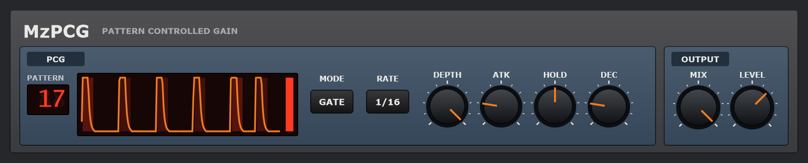

# MzPCG

**The PCF's idea, on the volume.** MzPCG is a VST3 effect, a *pattern-controlled gain*: on
every step of your project an envelope is struck to that step's level in one of 32
patterns, and it sets how loud the sound is. Put it on a pad and it's a trance gate; switch
it to DUCK and it's a sidechain pump without the sidechain; drop the HOLD and it chops a
loop into a rhythm.

It's the sibling of [MzPCF](https://github.com/simozzer/MzPCF), the pattern-controlled
filter from ReBirth RB-338. The patterns and the clock are MzPCF's, compiled from its
repository, so a pattern number means the same in both. Put a PCF and a PCG with the same
pattern on one track, and the filter and the gate play the same rhythm.

The controls:
- **PATTERN** - which of the 32 patterns plays the gain. Drag the number up or down, or use
  the wheel. The display draws each step's level and, over them, the gain the pattern makes
  with the knobs as they are. The step playing is lit, and the meter beside it shows the
  gain now.
- **MODE**:
  - **GATE**: each step opens the sound to its level, and it shuts between.
  - **DUCK**: each step pushes the sound down, and it comes back as the step lets go.
- **RATE** - how long a step is: 1/8, 1/16 or 1/32 of a note.
- **DEPTH** - how far it goes. At 0 the sound is left alone; at 100 a gate shuts to
  silence and a duck pushes all the way down.
- **ATK** - how fast a step takes hold, 0.5 to 50 ms. It is never so fast that it clicks;
  turned up, each step swells in.
- **HOLD** - how much of the step it holds there before letting go. None of it gives a
  pluck; all of it gives a square gate.
- **DEC** - then how fast it lets go, 5 ms to 1.5 s.
- **MIX** and **LEVEL** - dry to all through the gain, and -24 to +12 dB out.

The pattern follows your DAW's transport, to the sample: step 1 is the first step of every
bar, and it follows loops and tempo changes. With the transport stopped nothing is struck,
and the sound passes through untouched, so a track with MzPCG on it never goes quiet just
because nothing is playing.

## Some starting points

- **Trance gate**: GATE, pattern 3 (every step) or 17, HOLD about 60%, DEC short, ATK low.
- **Pump**: DUCK, pattern 1 (every beat), HOLD 0, DEC about 35%, DEPTH to taste.
- **Stutter**: GATE, RATE 1/32, pattern 2 or 7, HOLD about 40%.
- **Swell**: GATE, pattern 1, ATK up high, HOLD all the way, so each beat fades in.

## Installing

Download `MzPCG-<version>-win64-Setup.exe` from the
[releases page](https://github.com/simozzer/MzPCG/releases) and run it. It asks whether to
install for everyone or just you:

- **Everyone** (needs administrator rights) puts the VST3 in
  `C:\Program Files\Common Files\VST3`, which every DAW scans.
- **Just me** puts it in `%LOCALAPPDATA%\Programs\Common\VST3`. Some DAWs need that folder
  added to their plugin paths once; in Ableton Live it goes under
  *Preferences → Plug-Ins → VST3 Plug-In Custom Folder*.

Then rescan plugins in your DAW. The installer isn't code-signed, so Windows may warn about an
unknown publisher: choose *More info → Run anyway*. Uninstall from *Settings → Apps*.

## Building

Needs Visual Studio 2022+ with *Desktop development with C++*, and two repositories checked
out beside this one: JUCE (`..\JUCE`) and [MzPCF](https://github.com/simozzer/MzPCF)
(`..\MzPCF`), whose patterns and clock the PCG plays. Pass `-DJUCE_PATH=` or
`-DMZPCF_PATH=` to cmake if they are somewhere else.

    .\build.ps1                 engine check, then the VST3
    .\build.ps1 -NoPlugin       engine check only
    .\build.ps1 -Wav out        and render a trance gate and a pump into out\ to listen to
    .\build.ps1 -Release        and the release downloads into dist\: Setup.exe and a zip

`-Release` needs [Inno Setup 6](https://jrsoftware.org/isdl.php). The installer's script is
`installer\MzPCG.iss`, and it takes its version from `CMakeLists.txt`.

## Releasing

GitHub builds the downloads for every release and attaches them:

1. Bump the version in `CMakeLists.txt`.
2. Write the notes in `docs/releases/v<version>.md`, ending with the copyright line, then
   commit both.
3. Tag and push: `git tag -a v0.2.0 -m "MzPCG 0.2.0"`, then `git push origin main v0.2.0`.
4. The *release* workflow builds and checks the plugin, then makes a **draft** release with
   the notes and the two downloads. Read it over on GitHub and publish it.

## Layout

    Source/PCG/          the effect - plain C++, no JUCE
      Pcg.h/.cpp         the envelope and the gain, on MzPCF's patterns and clock
      Settings.h         the front panel, in panel units
    Source/              the JUCE plugin round it: parameters, look, editor
    Tests/PcgCheck.cpp   the engine's checks; gates the plugin build

## How it works

**The clock** is MzPCF's `StepClock`. At the top of every block the plugin reads where the
host's timeline is, and runs it forward sample by sample from there. A step starts on its
first sample, and playback started mid-step waits for the next one. RATE sets how many steps
fit in a beat. The pattern's sixteen steps run at that rate, so at 1/8 a pattern lasts two
bars, and at 1/32 half a bar.

**The envelope.** Each step strikes it to that step's level: 0 to 1, from the pattern's hex
digit, 0 to f. It holds there for HOLD of the step, then decays exponentially by DEC. A
one-pole filter with ATK's time constant rounds everything it does, so the gain can never
jump. The checks hold it to at most 1/(ATK × sample rate) a sample, even on the
hardest pattern.

**The gain.**
- **GATE**: the envelope is how open the sound is, `1 − DEPTH × (1 − env)`.
- **DUCK**: the envelope is how far the sound is pushed down, `1 − DEPTH × env`.

DEPTH, MIX and LEVEL are smoothed over 10 ms, so automating them doesn't zip.

## Licence

Copyright (C) 2026 Simon Moscrop. Free software under the GNU AGPL v3; see [LICENSE](LICENSE).
